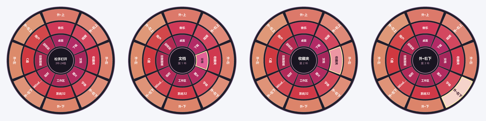
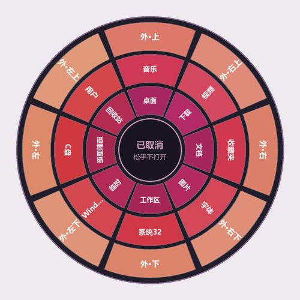

# Radial Menu — right-drag to open folders on Windows

[中文说明](README.md) · **English** · [](https://github.com/Kylinx-code/radial-menu/actions/workflows/build.yml)

> Hold the right mouse button and drag anywhere on Windows to summon a 3-layer, 24-cell radial menu; release over a cell to open that folder. Inspired by the gesture in [Quicker](https://getquicker.net/) — this is an independent implementation containing no Quicker code, icons or assets.





## Behavior

| Gesture | Result |
| --- | --- |
| Hold right button, drag, release over a cell | Opens the folder assigned to that cell |
| Plain right click (no drag) | Native Windows context menu appears normally |
| Drag beyond `cancel_margin` | Gesture is discarded: highlight cleared, nothing opens on release |
| Right click inside an excluded app | Fully passed through, no wheel (e.g. mind-mapping apps that pan with right-drag) |

## Highlights

- **Native menu stays intact.** The right-button DOWN event is swallowed, then a pure click is replayed asynchronously from a separate thread: no double menus, no frozen Explorer.
- **Fast under rapid dragging.** 3x supersampling + LANCZOS, 25+ pre-rendered frames, Per-Monitor DPI Aware V2. Crisp text on HiDPI, no stutter.
- **Configurable.** Radii, trigger distance, opacity (0-100), supersampling and cancel margin all live in `folders.json`.
- **Per-app exclusions.** Match by process name or window title, with `*mind*.exe`-style wildcards. The tray menu can sample the app under the cursor and add it automatically.
- **Tray resident.** Reload config, view exclusions, open the log, quit (or `Ctrl+Alt+Shift+Q`).
- **Auditable local log.** Every gesture and pass-through is written to `logs/radial.log` with rotation. **The app never connects to the network and uploads nothing.**
- **Edge-aware.** Near a screen edge the wheel center is clamped, and rendering and hit-testing share the same coordinates — no "point at one cell, open another".

## Download (no Python required)

Get the executables from [Releases](https://github.com/Kylinx-code/radial-menu/releases/latest):

| File | Purpose |
| --- | --- |
| `RadialMenu-setup.exe` | Recommended. Installs to `%LOCALAPPDATA%\RadialMenu`, creates desktop / Start Menu shortcuts, optional auto-start, includes an uninstaller |
| `RadialMenu-portable.exe` | Single file, just copy and double-click; config and logs are created next to the exe |

Both executables are functionally identical; they differ only in shortcuts, auto-start and uninstall. Rename them freely after download. Binaries are unsigned, so Windows SmartScreen may ask for "More info -> Run anyway" on first launch.

> Release asset names are ASCII because GitHub's upload API strips non-ASCII characters from the `name` parameter.

## Run from source

Windows + Python 3.9+:

```bash
pip install -r requirements.txt
python radial_click.py
```

Or double-click `启动轮盘菜单.vbs` (auto-detects a working Python interpreter, no console window). `启动轮盘菜单.bat` and `诊断环境.bat` help diagnose dependencies; `python radial_click.py --selftest` runs the built-in checks.

> A global low-level mouse hook cannot observe events from processes running elevated. If a window does not respond, run this app at the same integrity level.

## Configuration (`folders.json`)

Generated automatically in the app directory on first run (from `DEFAULT_CONFIG`); see [`folders.example.json`](folders.example.json). Edit it and use the tray's "Reload config" — no restart needed. The file contains personal paths and is git-ignored.

| Key | Default | Meaning |
| --- | --- | --- |
| `trigger_distance` | 18 | Pixels of drag before the wheel appears |
| `inner_radius` | 56 | Inner edge (dead zone radius) |
| `outer_radius` | 216 | Outer edge, split into 3 equal bands |
| `cancel_margin` | 80 | Beyond `outer_radius + this` the gesture is cancelled |
| `opacity` | 92 | 0-100, 100 = opaque |
| `render_scale` | 3 | Supersampling 1-4; higher is sharper but heavier |
| `exclude_processes` | `[]` | Process-name substrings, case-insensitive, `*` wildcards |
| `exclude_titles` | `[]` | Window-title substrings |
| `folders` | 24 | Cell contents, index = layer * 8 + direction |

`folders` order: **layer 0 (inner) -> 1 (middle) -> 2 (outer)**, 8 items per layer, with **direction 0 = straight up, then clockwise every 45°**. Each item is `{"name": "label", "path": "target"}`; paths accept environment variables (`%USERPROFILE%`), shell paths (`shell:RecycleBinFolder`) and commands (`control`).

## Build & CI

[`.github/workflows/build.yml`](.github/workflows/build.yml) builds both executables on `windows-latest` for every push to `main`, every pull request, and every `v*` tag:

- installs `requirements.txt` plus PyInstaller 6.22.3
- runs `packaging/RadialMenu.spec`, then embeds that exe via `packaging/Setup.spec`
- renames the outputs to `RadialMenu-portable.exe` / `RadialMenu-setup.exe` and uploads them as a build artifact (14-day retention)
- on a `v*` tag, additionally publishes a GitHub Release with both executables attached and auto-generated notes

To cut a release:

```bash
git tag v1.0.1
git push origin v1.0.1
```

CI also tries to install UPX to keep binaries small; if it is unavailable, PyInstaller silently falls back to uncompressed output (roughly 40% larger, functionally identical). For local builds see [`packaging/README.md`](packaging/README.md) (Chinese). The specs derive the repo root from PyInstaller's `SPECPATH`, so they contain no absolute paths.

## Repository layout

```
radial_click.py           main app (mouse hook / wheel / tray / log)
folders.example.json      scrubbed example config
make_icon.py              generates app.ico + icon preview
app.ico                   app / tray icon
启动轮盘菜单.vbs           console-free launcher
启动轮盘菜单.bat           console launcher with dependency check
诊断环境.bat               environment diagnostics
使用说明.txt               end-user guide (Chinese)
packaging/                installer source + PyInstaller specs + build notes
.github/workflows/        CI build & release workflow
wheel_preview.png         wheel preview
wheel_cancel_preview.png  cancel-state preview
app_icon_preview.png      icon preview
```

## Known limitations

- Windows only (`WH_MOUSE_LL` + Win32 layered windows).
- Unsigned binaries trigger SmartScreen; sign them yourself for enterprise deployment.
- Exclusions are resolved from the window under the cursor with the foreground window as fallback; some owner-drawn apps may also need `exclude_titles`.

## License

[MIT](LICENSE) (c) 2026 Xiaohang Duan
