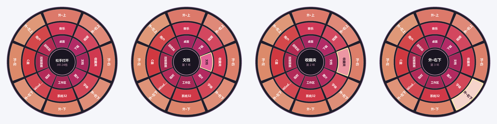
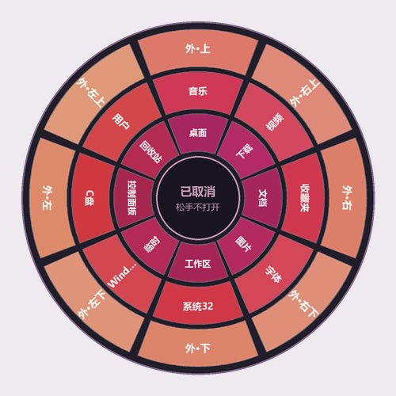

# 右键轮盘菜单 · Radial Menu

> Windows 上用「按住右键拖拽」快速打开文件夹。交互灵感来自 [Quicker](https://getquicker.net/)，本项目为独立实现，不含其代码、图标或资源。





## 它能做什么

在桌面或任意窗口按住鼠标右键拖动，光标附近弹出一个 **3 层 × 8 方向 = 24 格**的玫瑰图轮盘；把光标移到某一格，松手即打开对应文件夹。

| 操作 | 结果 |
| --- | --- |
| 按住右键拖动 → 停在格子上松手 | 打开该格子对应的文件夹 |
| 只单击一下右键（不拖动） | 正常弹出系统原生右键菜单 |
| 拖到轮盘外超过 `cancel_margin` | 本次手势作废：取消高亮，松手不打开任何东西 |
| 在已排除的程序里按右键 | 完全放行，不弹轮盘（例如思维导图右键拖画布） |

## 主要特性

- **不干扰原生菜单**：右键按下时先吞掉事件，纯单击通过独立线程异步重放，既不弹两次菜单，也不会卡住资源管理器。
- **快速拖动不卡**：3× 超采样 + LANCZOS 缩放、25 帧以上预渲染缓存、Per-Monitor DPI Aware V2；高分屏字体清晰，快速甩动不掉帧。
- **可自定义**：轮盘半径、触发距离、透明度（0–100）、超采样倍率、越界取消余量都写在 `folders.json`。
- **排除程序**：按进程名 / 窗口标题匹配，支持 `*mind*.exe` 之类通配符；托盘菜单「识别并添加排除程序」可自动采样鼠标下的软件并写回配置。
- **托盘常驻**：重新加载配置、查看排除列表、打开日志、退出（也可 `Ctrl+Alt+Shift+Q`）。
- **可审计日志**：所有手势与放行事件写入本地 `logs/radial.log`，自动轮转。**程序不联网、不上传任何数据。**
- **边缘自适应**：靠近屏幕边缘时轮盘圆心自动钳制，显示位置与命中判定共用同一坐标，不会「指哪不打哪」。

## 下载安装（不需要 Python）

前往 [Releases](https://github.com/Kylinx-code/radial-menu/releases/latest) 下载：

| 文件 | 说明 |
| --- | --- |
| `右键轮盘菜单-安装包.exe` | 推荐。装到 `%LOCALAPPDATA%\RadialMenu`，创建桌面/开始菜单快捷方式，可选开机自启，带卸载入口 |
| `免安装版-右键轮盘菜单.exe` | 单文件，拷过去双击即用；配置和日志生成在 exe 同目录 |

两个 exe 功能完全一致，区别只在快捷方式、自启与卸载。exe 未做代码签名，首次运行 Windows SmartScreen 可能提示「更多信息 → 仍要运行」。

## 从源码运行

要求 Windows + Python 3.9+：

```bash
pip install -r requirements.txt
python radial_click.py
```

或双击 `启动轮盘菜单.vbs`（自动探测可用的 Python 解释器，无控制台黑框）。`启动轮盘菜单.bat` / `诊断环境.bat` 用于排查依赖，`python radial_click.py --selftest` 可跑内置自检。

> 全局低级鼠标钩子收不到「以管理员身份运行」的程序发出的事件；如果某个窗口不生效，让本程序以相同权限运行即可。

## 配置 `folders.json`

首次运行会在程序目录自动生成一份（内容取自 `DEFAULT_CONFIG`），可参考 [`folders.example.json`](folders.example.json)。改完在托盘点「重新加载配置」立即生效，无需重启。此文件含个人路径，已加入 `.gitignore`，不会提交。

| 字段 | 默认 | 说明 |
| --- | --- | --- |
| `trigger_distance` | 18 | 拖动超过多少像素才弹轮盘 |
| `inner_radius` | 56 | 内环内缘（中心死区半径） |
| `outer_radius` | 216 | 最外环外缘，3 环等分 |
| `cancel_margin` | 80 | 离圆心超过 `outer_radius + 本值` 即作废 |
| `opacity` | 92 | 透明度 0–100，100 = 不透明 |
| `render_scale` | 3 | 超采样倍率 1–4，越高越清晰、越吃资源 |
| `exclude_processes` | `[]` | 进程名关键字，不区分大小写，支持 `*` 通配符 |
| `exclude_titles` | `[]` | 窗口标题关键字 |
| `folders` | 24 项 | 格子内容，索引 = 层 × 8 + 方向 |

`folders` 顺序：**层 0（内环）→ 层 1（中环）→ 层 2（外环）**，每层 8 项按 **方向 0 = 正上方、顺时针每 45°** 依次排列。每项形如 `{"name": "显示名", "path": "路径"}`；路径支持环境变量（`%USERPROFILE%`）、Shell 特殊路径（`shell:RecycleBinFolder`）和命令（`control`）。

## 重新打包

见 [`packaging/README.md`](packaging/README.md)。用 PyInstaller 可生成上面两个 exe；spec 不含任何绝对路径，换台机器可直接用。

## 目录结构

```
radial_click.py           主程序（鼠标钩子 / 轮盘渲染 / 托盘 / 日志）
folders.example.json      示例配置（已脱敏）
make_icon.py              生成 app.ico 与图标预览
app.ico                   程序 / 托盘图标
启动轮盘菜单.vbs           无黑框启动（自动探测 Python）
启动轮盘菜单.bat           带控制台启动 + 依赖自检
诊断环境.bat               环境诊断
使用说明.txt               面向最终用户的中文说明
packaging/                安装器源码与 PyInstaller spec
wheel_preview.png         轮盘预览
wheel_cancel_preview.png  越界取消态预览
app_icon_preview.png      图标预览
```

## 已知限制

- 仅支持 Windows（`WH_MOUSE_LL` + Win32 分层窗口）。
- exe 未签名，会触发 SmartScreen；企业环境可自行签名。
- 排除程序按「鼠标位置下的窗口 + 前台窗口兜底」判定，个别自绘窗口可能需要同时配置 `exclude_titles`。

## 许可

[MIT](LICENSE) © 2026 Xiaohang Duan
